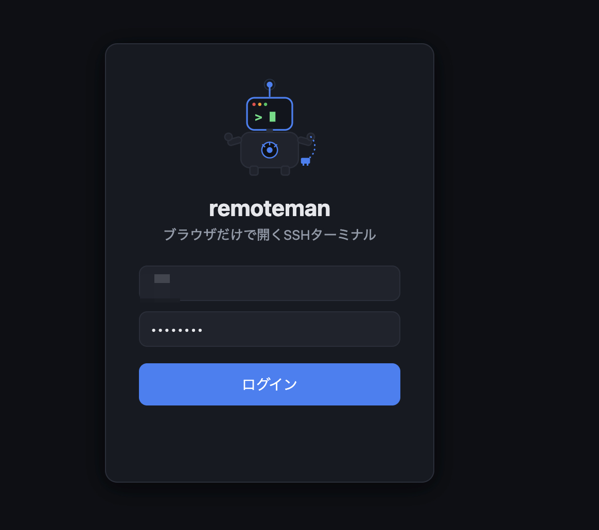
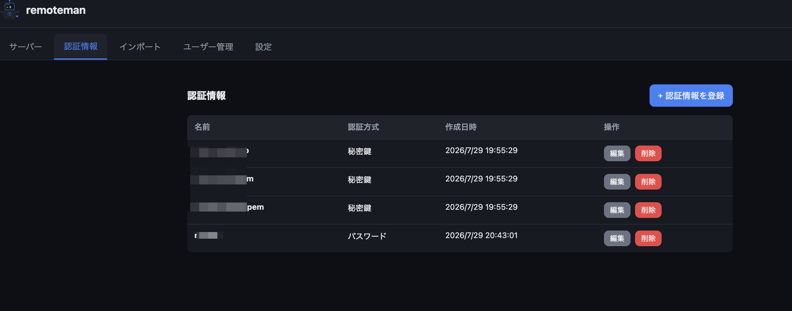
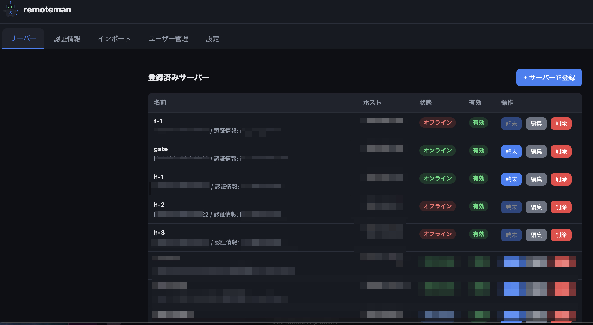
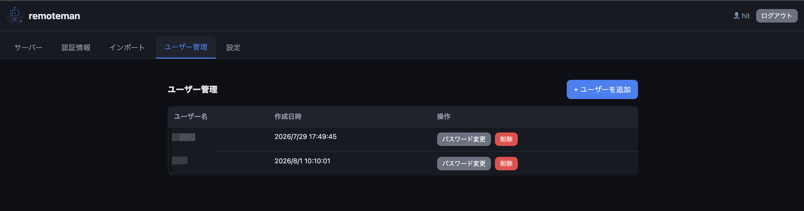
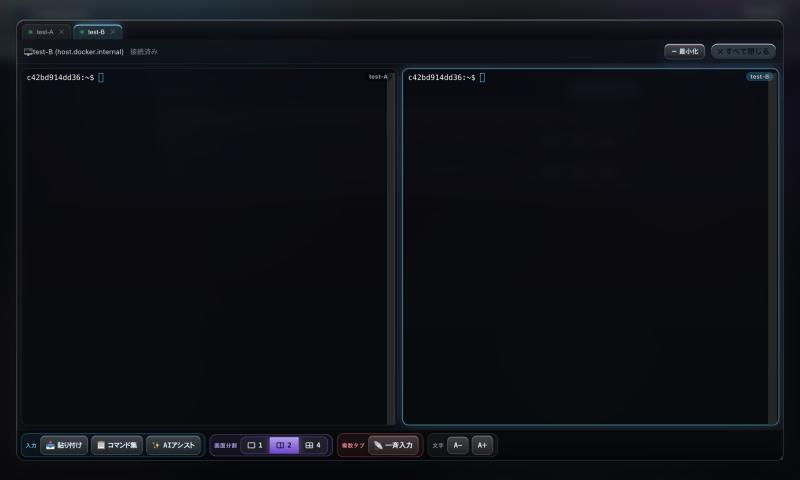
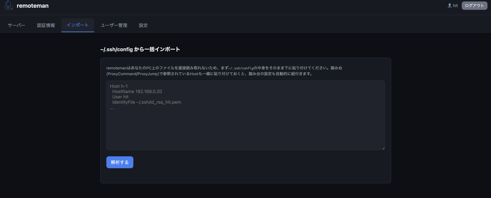
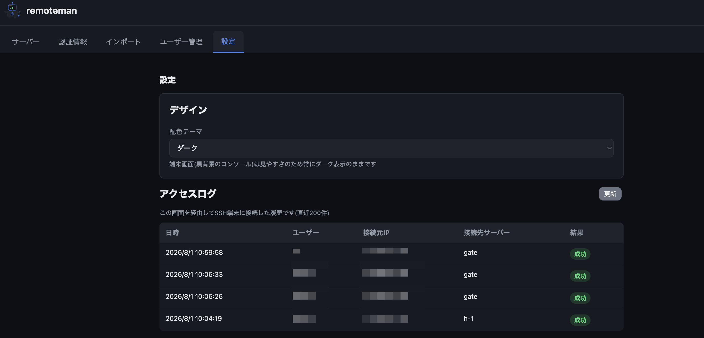

# remoteman


ブラウザだけで開ける、SSH Webターミナルです。ガラス調の動くUI、スマホ向けの特殊キーバー、切れても同じシェルに戻れる再接続、PC向けの最大4分割、AIによるコマンド提案まで備えています。サーバーを登録しておけば、ブラウザのタブを開くだけで対話的なSSHシェルにアクセスできます([xterm.js](https://xtermjs.org/)使用)。ローカルにSSHクライアントが入っていない端末(スマホ・共有PC・会社のロックダウンされたPCなど)からでも、認証さえ通れば自宅・オフィスのサーバーにログインできます。

マスコットキャラクターは「リモまん」。SSHケーブルを握った、ターミナル画面が顔のロボットです。

Dockerコンテナ1つだけで動作し、特定のホストや環境に依存しない作りになっています。

---

## できること・できないこと

remotemanは「ブラウザからSSHログインする」ことだけに機能を絞ったツールです。

| できること | 概要 |
|---|---|
| サーバー(端末)登録 | 接続したいサーバーをホスト・SSH情報でWebUIから登録 |
| 認証情報の使い回し | SSHの秘密鍵/パスワードは「認証情報」タブで個別に登録し、サーバー登録時はセレクトで選ぶだけ(同じ鍵を複数台で共有可能) |
| 踏み台(ProxyJump)接続 | サーバー登録時に別の登録済みサーバーを「踏み台」として指定でき、多段SSH接続ができる(外部sshコマンドは使わず、paramikoのトンネリングのみで実現) |
| `~/.ssh/config` 一括インポート | configの中身を貼り付けて解析し、Host/HostName/User/Port/IdentityFile/ProxyCommand・ProxyJumpを検出、選んだホストと秘密鍵をまとめて取り込める |
| `~/.ssh/config` 形式エクスポート | 登録済みサーバー一覧をssh config形式のテキストとしてダウンロード(秘密鍵/パスワードは含まれません) |
| 秘密鍵のインポート | 認証情報登録時、鍵ファイルを選択すると自動でテキスト欄に読み込まれる(ブラウザ内で読み込むだけで、ファイル自体はサーバーに送信されない) |
| Webターミナル | 登録したサーバー名の横の「端末」ボタンをクリックすると、ブラウザ上でSSH対話シェルが開く |
| オンライン/オフライン確認 | SSHポートへの疎通確認で簡易的な稼働状態を自動表示(オンライン時のみ「端末」ボタンが有効) |
| 認証 | JWTによるログイン認証、ログイン失敗の連続でロックアウト |
| ユーザー管理 | WebUIから利用者アカウントを追加・削除・パスワード変更 |
| 認証情報の暗号化保存 | 登録したSSHパスワード/秘密鍵はDB上で暗号化して保存 |
| 複数タブ・最大4分割 | 複数サーバーを同時に開き、PCでは1/2/4画面に分割して並べて操作 |
| 再接続可能セッション | 回線切断・スマホのスリープ後も、同じシェル(実行中のコマンド・環境変数ごと)へ自動復帰 |
| スマホ向け操作 | Esc/Tab/Ctrl/Alt/矢印などの特殊キーバー、ピンチで文字サイズ変更、ソフトキーボードに隠れない画面 |
| コマンド集 | よく使うコマンドを登録し、タップで送信 |
| 一斉入力 | 入力を開いている全タブへ同時送信(確認ダイアログ・警告表示つき) |
| AIアシスト(任意) | 日本語の依頼→コマンド提案、端末出力の解説(自動実行はしない) |
| 自動デプロイ | `scripts/autodeploy.sh`をcronで回すpull型CD(ヘルスチェック・ロールバック付き) |
| デザイン | ガラス質感+動く背景のダークUI(配色テーマは固定ダーク) |
| ログ閲覧 | WebUIへのログイン試行・SSH端末への接続試行を、日時・接続元IP・結果とともに記録し「設定」タブから閲覧可能 |

**含まれないもの:** シャットダウン実行、Wake-on-LAN起動、スケジュール実行、実行ログ。電源管理まで含めたツールが必要な場合は姉妹プロジェクトの[pm-tool](../pm-tool)を使ってください。remotemanはpm-toolのWebターミナル部分だけを切り出して作られています。

---

## システム構成

```
┌──────────────────────────────────────────┐
│  ブラウザ  http://<ホスト>:8091          │
└───────────────────┬──────────────────────┘
                    │ JWT認証 / WebSocket
┌───────────────────▼──────────────────────┐
│  remoteman コンテナ (bridge network)     │
│  ┌────────────────────────────────────┐ │
│  │ FastAPI + Uvicorn                  │ │
│  │  - 認証/ユーザー管理                │ │
│  │  - サーバー登録CRUD                 │ │
│  │  - オンライン確認(TCP疎通)         │ │
│  │  - Webコンソール(WebSocket)        │ │
│  ├────────────────────────────────────┤ │
│  │ SQLite (/data/remoteman.db)        │ │
│  └────────────────────────────────────┘ │
└───────────────────┬──────────────────────┘
                    │ SSH
              ┌─────▼─────┐
              │ 接続先サーバー │
              └───────────┘
```

pm-toolと異なり、Wake-on-LAN用のブロードキャストパケットを送る必要がないため、`network_mode: host`ではなく通常のbridgeネットワーク+ポートマッピングで動作します。

---

## 必要なもの

- Docker Engine + Docker Compose(または Docker Desktop)
- 接続先サーバーへSSH接続できるユーザーアカウント(公開鍵 または パスワード認証)
- remotemanを動かすホストから、接続先サーバーのSSHポートに到達できるネットワーク

---

## セットアップ手順

### 1. リポジトリをクローン

```bash
git clone git@github.com:hit1023/remoteman.git
cd remoteman
```

### 2. 環境変数ファイルを作成

```bash
cp .env.example .env
```

`.env` に設定が必要な項目:

| 変数名 | 必須 | 説明 |
|---|---|---|
| `APP_SECRET_KEY` | ✅ | JWT署名 と SSH認証情報の暗号化に使う秘密鍵。下記コマンドで生成 |
| `ADMIN_USERNAME` | - | 初回起動時に作成される初期管理者のユーザー名(既定値: `admin`) |
| `ADMIN_PASSWORD` | ✅ | 初期管理者のパスワード。**初回起動時のみ**使われます |
| `JWT_EXPIRE_HOURS` | - | ログインの有効期限(時間、既定24) |
| `APP_PORT` | - | 待受ポート(既定8091) |
| `SESSION_KEEPALIVE_SECONDS` | - | WebSocketが切れた後にSSHシェルを保持する秒数(既定900) |
| `CF_ACCOUNT_ID` / `CF_API_TOKEN` / `CF_GATEWAY_ID` | - | AIアシストの初期値(任意)。通常は設定タブの「AIアシスト(LLM)設定」から画面で設定できます |
| `AI_MODEL` | - | AIアシストのモデル(既定`@cf/meta/llama-3.3-70b-instruct-fp8-fast`) |

`APP_SECRET_KEY` の生成コマンド:

```bash
python3 -c "from cryptography.fernet import Fernet; print(Fernet.generate_key().decode())"
```

出力された文字列を `.env` の `APP_SECRET_KEY=` の後に貼り付けます。

> **注意:**
> - `.env` は `.gitignore` に含まれており、GitHubにはアップロードされません
> - `APP_SECRET_KEY` を後から変更すると、**それまでログイン済みのトークンが全て無効になり**、かつ**登録済みサーバーのSSHパスワード/秘密鍵が復号できなくなります**(再登録が必要)。運用開始後は変更しないでください
> - `ADMIN_PASSWORD` は初回起動(ユーザーテーブルが空の状態)でのみ有効です。2回目以降の起動には影響しません。パスワードを変更したい場合はWebUIの「ユーザー管理」から行ってください

### 3. コンテナを起動

```bash
docker compose up -d --build
```

### 4. 起動確認

```bash
docker compose ps
docker compose logs -f remoteman
```

ログに `初期管理者ユーザー 'admin' を作成しました` のような行が出ていれば初回セットアップは成功です。

### 5. ブラウザでアクセス

```
http://<remotemanを動かしているホストのIP>:8091
```

`.env` に設定した `ADMIN_USERNAME` / `ADMIN_PASSWORD` でログインします。



---

## 認証について(外部公開する場合は必読)

remotemanは実サーバーへの対話的SSHアクセスを提供するツールのため、外部(インターネット)に公開する場合は特に以下に注意してください。

- **必ずHTTPSリバースプロキシ配下に置いてください**(nginx-proxy-manager、Caddy、Cloudflare Tunnel等)。remoteman自体はHTTPで待ち受けるため、素のHTTPで直接インターネットに公開しないでください(WebSocketもwss化されます)
- ログインはJWT(`Authorization: Bearer <token>`)で行い、トークンはブラウザの`localStorage`に保存されます(`JWT_EXPIRE_HOURS`で有効期限を設定)
- 同一ユーザー名で**5回連続ログインに失敗すると5分間ロックアウト**されます(総当たり攻撃対策)
- 新規登録画面は存在しません。利用者を増やしたい場合は、ログイン後に「ユーザー管理」タブから追加してください(全ユーザーが同一権限です)
- 登録したサーバーのSSHパスワード/秘密鍵は`APP_SECRET_KEY`から導出した鍵でDB上に暗号化保存され、WebUI/APIから平文で読み出すことはできません
- Webコンソールの接続は、短命(30秒・1回限り)の接続チケットを発行してから`/ws/console/{id}`のWebSocketへ接続する方式です。JWTトークン自体をWebSocket接続に使い回さないための仕組みです

---

## 認証情報とサーバー(端末)登録の手順

SSHの秘密鍵/パスワードと、サーバー自体の登録は別のタブに分かれています。同じ鍵を複数台のサーバーで使い回している場合、認証情報は1回登録するだけで済みます。

### 1. 認証情報を登録する

「認証情報」タブの「+ 認証情報を登録」から登録します。

| 項目 | 説明 |
|---|---|
| 名前 | WebUI上での表示名(任意の文字列、例: `共通SSH鍵(hit)`) |
| 認証方式 | 秘密鍵 または パスワード |
| 秘密鍵/パスワード | 選んだ認証方式に応じた認証情報。編集時、空欄のままなら既存の値は変更されません |
| 秘密鍵のパスフレーズ | 秘密鍵にパスフレーズを設定している場合のみ入力(任意) |

登録した認証情報は、使用中のサーバーが1台でもある間は削除できません。



### 2. サーバーを登録する

「サーバー」タブの「+ サーバーを登録」から、接続したいサーバーを登録します。

| 項目 | 説明 |
|---|---|
| 表示名 | WebUI上での表示名(任意の文字列) |
| ホスト | SSH接続先のIPアドレス/ホスト名 |
| SSHポート | 既定22 |
| SSHユーザー | ログインするユーザー |
| 認証情報 | 事前に登録した認証情報をセレクトから選択(未設定のままだと端末は開けません) |



### 3. ユーザーを管理する(任意)

「ユーザー管理」タブから、WebUIにログインできる利用者を追加・削除したり、パスワードを変更できます(全ユーザーが同一権限です)。



---

## Webターミナル

「サーバー」タブの操作列にある「端末」ボタンをクリックすると、ブラウザ上にターミナルが開き、SSH経由で対話的にログインできます([xterm.js](https://xtermjs.org/)を使用、外部CDNには依存せずリポジトリに同梱)。「端末」ボタンは状態が**オンライン**、または**踏み台経由**のサーバーで有効になります(オフライン/未確認/エラーの場合はグレーアウトして押せません)。



- サーバー登録時に選択した「認証情報」でSSH接続します(認証情報が未設定、またはサーバーが無効化されている場合は開けません)
- OS問わず(Linux/macOS/Windowsの OpenSSH Server)同じ仕組みで動作します。ただしWindowsの古い`cmd.exe`は端末制御シーケンスの扱いが異なるため表示が乱れることがあります
- **ウィンドウに追従**: 端末の枠は画面の約96%×92%に自動で広がり、ブラウザを最大化/リサイズすると行数・列数も自動で追従します(右下のハンドルで手動リサイズも可能)
- **タブ**: 複数のサーバーを同時に開けます。それぞれ独立したSSHセッションです。同じサーバーの「端末」を再度押すと既存タブに切り替わります。タブ左のLEDは状態を表します(緑=接続中、黄=接続中・再接続中、赤=切断)
- **最小化**: 「－ 最小化」で接続を維持したままサーバー一覧に戻れます。右下の「🖥 端末を表示」でいつでも呼び戻せます
- **演出**: 出力が流れている間は端末の縁がうっすら光り、接続時にスキャンラインが走ります(OSの「視差効果を減らす」設定で無効化されます)

### 下部ツールバー(機能ごとに色分け)

| グループ | ボタン | できること |
|---|---|---|
| 入力(水色) | 📥 貼り付け | クリップボードの内容を端末へ貼り付け(スマホ向け) |
| | 📋 コマンド集 | 登録したコマンドをタップで送信。「Enterも送る」で即実行/入力のみを選択。名前+コマンドを追加・削除できる(ブラウザの`localStorage`に保存) |
| | ✨ AIアシスト | 下記「AIアシスト」参照 |
| 画面分割(紫・PCのみ) | 1 / 2 / 4 | 端末の並べ方を切り替え。現在の方式がハイライトされます |
| 複数タブ(赤) | 📡 一斉入力 | 入力を開いている全タブへ同時送信 |
| 文字 | A− / A＋ | 文字サイズ変更(設定は保存されます) |

画面幅が狭い(〜720px)か、タッチ端末では、これに加えて**特殊キー**(Esc / Tab / Ctrl / Alt / ← ↓ ↑ → / Home / End / PgUp / PgDn / `|` `~` `/` `-` / ^C / ^D)が先頭に並びます。**Ctrl・Altはタップで固定**され、次の1キーに作用して自動で解除されます(例: `Ctrl`→`r` で履歴検索)。ボタンを押してもソフトキーボードは閉じません。

### 画面分割(PCのみ)

幅1000px以上でマウス操作できる環境で、ツールバーに「画面分割」が現れます。

- **1**: 選択中のタブだけ表示 / **2**: 左右2画面 / **4**: 2×2。ただし4でタブが2つ以下の間は縦いっぱいの2列で表示します
- 各ペインの右上に**サーバー名**が出ます。操作対象のペインは**水色の枠**とラベルで強調されます
- **ペインをクリックした側にだけキー入力が届きます**(他のペインには送られません)
- 開いているタブがペイン数を超えると、タブの順で先頭から割り当てられ、選択したタブは必ず表示されます
- 選択方式は保存され、次回も維持されます。スマホ・狭い画面では自動的に1画面表示になります

### 一斉入力(取り扱い注意)

「📡 一斉入力」をオンにすると、**入力したキーが開いている全タブ(全サーバー)に送られます**。複数台に同じ操作をしたい場面向けですが、誤爆すると危険なため次の安全策を入れています。

- オンにするときに**確認ダイアログ**が出ます
- オン中は端末の枠が**赤く光り**、上部に**赤いバナー**が出ます(バナーの「OFFにする」ですぐ解除)
- 画面分割の切り替え・タブの追加/閉じる・最小化をすると**自動でオフ**になります
- タブが1つのときはオンにできません

### 再接続できるセッション

スマホの画面スリープや回線切替、一時的なネットワーク断でWebSocketが切れても、**サーバー側のSSHシェルは`SESSION_KEEPALIVE_SECONDS`(既定15分)保持**されます。ブラウザは指数バックオフ(最大15秒間隔・最大20回)で自動再接続し、タブが可視に戻った時・オンライン復帰時には即座に再接続を試みます。再接続すると、**実行中のコマンド・環境変数・カレントディレクトリがそのまま残り**、切れていた間の出力(直近256KB)が再生されます。

- タブの「✕」や「すべて閉じる」を押したとき、およびシェルが`exit`で終了したときは、サーバー側のセッションも終了します(再接続しません)
- 保持期間を過ぎた場合や、サーバー再起動後は新しいセッションを開始し、その旨をターミナルに表示します
- ページの再読み込み(F5)は新規接続になります(以前のセッションには自動では戻りません)

### AIアシスト(任意)

設定タブの「✨ AIアシスト(LLM)設定」で使うLLMを選べます。**メインは Cloudflare AI Gateway 経由の Workers AI**(アカウントID・ゲートウェイID・APIトークンを入力。ダッシュボードでログ/コスト/キャッシュを確認できます)。他に Claude(Anthropic)と、OpenAI互換(OpenAI / xAI Grok / Gemini / Ollama などプリセット付き)を選択可能で、Anthropic/OpenAIもAI Gateway経由にできます。APIキーは暗号化して保存し、画面には表示しません。「接続テスト」で疎通確認できます。未設定の場合はパネルに「無効です」と表示されます。

- **コマンド生成**: 「80番ポートを使っているプロセスを探して」のように日本語で依頼すると、1行のコマンドと日本語の説明を提案します。「入力欄に挿入」(Enterは押さない)か「そのまま実行」を選べます。**自動では実行しません**
- **危険コマンドの警告**: `rm -rf`、`mkfs`、`dd if=`、シャットダウン/再起動、`chmod -R 777`、`DROP TABLE`など破壊的な可能性があるものは警告を出し、「そのまま実行」ボタンを隠します
- **出力の解説**: 「直近の出力を解説」は、**画面末尾の約60行を設定中のLLMへ送信**して原因と次の一手を説明します。機密情報が画面に出ているときは使わないでください(送信は押したときだけです)

---

## 踏み台(ProxyJump)経由の接続

サーバー登録フォームの「踏み台(ProxyJump、任意)」で、別の登録済みサーバーを踏み台として指定できます。SSH configの`ProxyCommand`/`ProxyJump`に相当する機能です。

- 踏み台自体も1台のサーバーとして事前に登録し、認証情報を設定しておく必要があります
- 踏み台の踏み台、さらにその踏み台…という多段接続にも対応しています(上限8段)
- 外部の`ssh`コマンドは使わず、paramikoの`direct-tcpip`チャネルでトンネルを組む方式のため、コンテナに`ssh`バイナリや秘密鍵ファイルを配置する必要はありません
- 自分自身を踏み台に指定する、または循環する設定(A→B→Aのような)は登録時にエラーになります
- 踏み台として使用中のサーバーは削除できません(先に参照を解除してください)

---

## `~/.ssh/config` のインポート・エクスポート

「ツール」タブから、`~/.ssh/config`形式でのインポート・エクスポートの両方ができます。

### エクスポート

登録済みのサーバー一覧を、`~/.ssh/config`形式のテキストファイルとしてダウンロードできます。Host/HostName/Port/User/ProxyJumpに加えて、秘密鍵認証のサーバーには`IdentityFile ~/.ssh/<認証情報名>`も出力されます。ただし**秘密鍵の中身/パスワードそのものは含まれません**(remotemanは登録済みの認証情報を平文で読み出せない設計のため)。実際の鍵ファイルを認証情報名と同じファイル名で`~/.ssh/`以下に配置してご利用ください。パスワード認証のサーバーにはIdentityFileは出力されず、認証方式がコメントとして記載されるのみです。

### インポート

手元の`~/.ssh/config`の内容をまとめて取り込めます。remotemanはブラウザ経由でしかローカルファイルにアクセスできないため、以下の2ステップが必要です。

1. **configの中身をテキストエリアに貼り付けて「解析する」をクリック**— `Host` / `HostName` / `User` / `Port` / `IdentityFile` / `ProxyCommand`(`ssh -W %h:%p <alias>`形式) / `ProxyJump` を解析します。`Host *`のようなワイルドカードブロックは自動的に除外されます。踏み台先(`nuro-jump`など)を経由するホストがある場合、踏み台側のHostエントリも一緒に貼り付けておくと、インポート時に自動で踏み台として紐付きます
2. **鍵ファイルを選択(またはペースト)してホストを選び、「選択したホストをインポート」をクリック** — configで参照されている`IdentityFile`のパスごとに鍵の中身を求められます。ファイル選択時はブラウザ内で読み込むだけで、ファイルそのものがサーバーに送信されるわけではありません(読み込んだテキスト内容だけを送信します)。既にremotemanへ登録済みの鍵は「既存の認証情報を使う」から選べます

インポート時の注意点:

- 同名のサーバーが既に存在する場合はスキップされます(結果メッセージに表示されます)
- `IdentityFile`が複数行指定されている場合は最初の1つのみ採用します
- `ProxyJump`がカンマ区切りで複数ホップ指定されていても、remotemanは1段分(先頭のエイリアス)のみ取り込みます。多段が必要な場合はインポート後にサーバー編集画面で調整してください



---

## 設定・ログ閲覧

「設定」タブから、配色テーマの切り替えと各種ログの閲覧ができます。

- **配色テーマ**: ガラス調のダーク表示に統一しました(セレクトは旧設定の名残で、現在は切り替わりません)
- **ログイン履歴**: WebUIへのログイン試行を、日時・ユーザー名・接続元IP・結果(成功/失敗)とともに記録(直近200件)。ロックアウトやパスワード誤りなど失敗した試行も記録されます
- **アクセスログ**: この画面を経由してSSH端末に接続した履歴を、日時・ユーザー・接続元IP・接続先サーバー・結果とともに記録(直近200件)



---

## データの永続化

| データ | 保存先 |
|---|---|
| サーバー登録情報・認証情報・ユーザー | SQLite(`./data/remoteman.db`、Dockerボリュームマウント) |
| ログイン認証トークン | ブラウザの`localStorage` |
| コマンド集・文字サイズ・分割方式 | ブラウザの`localStorage`(端末ごと。サーバー側には保存されません) |
| SSHシェルの再接続用セッション | remotemanコンテナのメモリ上(コンテナを再起動すると消えます) |

`docker compose down` してもデータは消えません。完全に削除する場合は `./data` ディレクトリを削除してください。

---

## 技術スタック

| レイヤー | 使用技術 |
|---|---|
| フロントエンド | HTML / CSS / Vanilla JavaScript(SPA、ビルド不要) |
| バックエンド | FastAPI + Uvicorn(Python 3.11) |
| DB | SQLite(SQLAlchemy ORM) |
| SSH実行 | paramiko |
| Webコンソール | FastAPI WebSocket + paramiko対話シェル、フロントエンドは`xterm.js`(MITライセンス、リポジトリに同梱) |
| 認証 | JWT(`python-jose`) + bcrypt(`passlib`) |
| 認証情報暗号化 | `cryptography`(Fernet) |
| AIアシスト | Cloudflare AI Gateway(Workers AI)をメイン、Anthropic / OpenAI互換も選択可(REST、`urllib`のみで追加依存なし) |
| デプロイ | pull型CD(cron + `scripts/autodeploy.sh`) |

---

## 主なコマンド

```bash
# 起動(初回・コード変更後)
docker compose up -d --build

# 起動(通常時)
docker compose up -d

# 停止
docker compose down

# ログ確認
docker compose logs -f remoteman

# .envの変更を反映(再ビルド不要)
docker compose up -d --force-recreate remoteman

# コンテナ内のSQLiteに直接アクセス
docker exec -it remoteman python3 -c "import sqlite3; print(sqlite3.connect('/data/remoteman.db').execute('select name from sqlite_master').fetchall())"
```

---

## トラブルシューティング

### ログインできない / 初期管理者が作成されない

```bash
docker compose logs remoteman | grep -i admin
```

`ADMIN_PASSWORDが未設定のため初期管理者を作成できません` と出ている場合は `.env` に `ADMIN_PASSWORD` を設定し、`docker compose up -d --force-recreate remoteman` を実行してください。

初期管理者は**ユーザーテーブルが空のときのみ**作成されます。一度でも作成された後は`.env`の値を変えても反映されません(WebUIの「ユーザー管理」から変更してください)。

### 「端末」ボタンが押せない

サーバーの状態バッジが「オンライン」になっているか確認してください。オフライン/未確認/エラーの場合はボタンが無効化されます。よくある原因:

- 接続先のSSHポートがファイアウォールでブロックされている
- ホスト名/IPアドレスの指定が間違っている
- remotemanコンテナから接続先サーバーへのネットワーク経路がない(別セグメント、VPN未接続等)

### コンソール接続時に「SSH接続に失敗しました」と出る

エラーメッセージの詳細がターミナル内に表示されます。よくある原因:

- SSHの秘密鍵/パスワードが間違っている、または未登録
- 秘密鍵にパスフレーズが設定されているのに未入力(または逆)
- SSHユーザー名が間違っている

### `APP_SECRET_KEY`を変更したら登録済みサーバーの認証情報が使えなくなった

`APP_SECRET_KEY`はSSH認証情報の暗号化鍵を兼ねているため、変更すると復号できなくなります。変更前の値が分かる場合は元に戻すか、分からない場合は影響を受けたサーバーの認証情報を再登録してください。

### 踏み台(ProxyJump)経由の接続に失敗する

エラーメッセージに、チェーンのどのホップで失敗したか(サーバー名)が含まれます。よくある原因:

- 踏み台サーバー自体に認証情報が設定されていない
- 踏み台サーバーからさらに先(目的のサーバー)へのネットワーク経路がない、またはSSHポートがブロックされている
- 踏み台サーバーが無効化されている、または削除されている

### 切断されたまま再接続しない

- 画面に「再接続に失敗しました」と出ている場合は、タブを閉じて「端末」を開き直してください(20回試行した後に停止します)
- 長時間(`SESSION_KEEPALIVE_SECONDS`超)切れていた場合や、remotemanを再起動した場合は、新しいセッションになります

### 一斉入力を切ったのに複数のタブに入力される

赤いバナー(「📡 一斉入力ON」)が出ていないか確認してください。バナーがなければ入力は選択中のペインにだけ届きます。分割表示では**ペインをクリックして**操作対象を切り替えます。

### AIアシストが「無効です」と出る

設定タブの「AIアシスト(LLM)設定」でプロバイダーとAPIキーを設定してください(`.env`の`CF_*`でも初期値を渡せます。変更後は`docker compose up -d`)。

### 画面分割ボタンが出ない

幅1000px未満、またはタッチ端末では表示されません(1画面固定)。ブラウザ幅を広げてください。

### `~/.ssh/config`インポートで一部のホストがスキップされる

結果メッセージのスキップ理由を確認してください。多くの場合「同名のサーバーが既に存在する」ことが原因です。登録名が重複している場合は、インポート前のプレビュー画面で「登録名」欄を編集してから取り込んでください。

---

## 自動デプロイ(CD)

`scripts/autodeploy.sh`は、cronから定期実行するpull型のデプロイスクリプトです(GitHub Actionsのself-hosted runnerを使わずに済みます)。

1. `git fetch origin main`し、新しいコミットがなければ何もしない
2. `git reset --hard origin/main` → `docker compose up -d --build`
3. `http://localhost:<APP_PORT>/`のヘルスチェック(最大60秒)
4. 失敗したら直前のコミットへ戻して再ビルド(ロールバック)

`.env`と`data/`はgit管理外なので影響しません。サーバー側の`crontab`例(3分ごと、多重起動防止に`flock`):

```cron
*/3 * * * * flock -n /tmp/remoteman-autodeploy.lock /home/<user>/docker/remoteman/scripts/autodeploy.sh >> /home/<user>/docker/remoteman/autodeploy.log 2>&1
```

> **注意:** デプロイは`git reset --hard`のため、サーバー上でコードを直接編集しても次回のデプロイで戻ります。変更は必ずリポジトリ経由で行ってください。

---

## ディレクトリ構成

```
remoteman/
├── docker-compose.yml       # bridge network, ポート8091, dataボリューム
├── .env.example              # 環境変数サンプル
├── scripts/
│   └── autodeploy.sh          # pull型自動デプロイ(cronから実行)
├── images/                    # READMEに埋め込むスクリーンショット
├── app/
│   ├── Dockerfile
│   ├── requirements.txt
│   ├── main.py                # FastAPIルーティング
│   ├── database.py            # DB接続設定
│   ├── models.py               # User/Credential/Server/AccessLog/LoginLog
│   ├── schemas.py              # Pydanticスキーマ
│   ├── auth.py                 # JWT/パスワードハッシュ/ログイン制限
│   ├── crypto.py                # SSH認証情報の暗号化/復号
│   ├── netutil.py               # 接続元IPアドレス取得(X-Forwarded-For対応)
│   ├── ssh_key.py               # 秘密鍵パース
│   ├── ssh_connect.py           # 踏み台(ProxyJump)対応の多段SSH接続
│   ├── ssh_config_parser.py     # ~/.ssh/config のパーサー
│   ├── import_ssh.py            # configインポートAPI(解析/取り込み)
│   ├── console.py               # Webコンソール(WebSocket + 再接続可能セッション)
│   └── ai_assist.py             # AIアシストAPI + LLM設定(AI Gateway/Anthropic/OpenAI互換)
└── webui/
    ├── index.html               # フロントエンドSPA
    ├── mascot.svg                # マスコット「リモまん」
    └── vendor/xterm/             # xterm.js(同梱、MITライセンス)
```

---

## 更新履歴

### 2026-11-04

- UIを全面刷新(ガラス質感・動くオーロラ背景・接続LEDの脈動・出力時の縁の発光・接続時のスキャンライン)
- 端末の枠をウィンドウ追従に変更(最大化に連動)。ペインごとに自動でリフィットし、プロンプトの見切れを解消
- スマホ向けの特殊キーバー(Ctrl/Alt固定、矢印、貼付ほか)、ピンチで文字サイズ変更、ソフトキーボード対応
- 再接続可能セッション(WebSocket切断後もSSHシェルを保持して自動再接続、出力を再生)
- 画面分割(1/2/4、PCのみ)、ツールバーを機能別に色分け・見出し付きのグループへ整理
- 一斉入力(確認ダイアログ・赤い警告・自動OFFの安全策つき)、コマンド集
- AIアシスト(LLMは設定画面で選択、Cloudflare AI Gatewayがメイン。コマンド提案と出力解説、危険コマンド警告)
- pull型自動デプロイ(`scripts/autodeploy.sh`)を追加

### 2026-08-01(4)

- 「インポート」タブを「ツール」に改称(configのインポートに加えてエクスポートも含むため)
- configエクスポートで、秘密鍵認証のサーバーには`IdentityFile ~/.ssh/<認証情報名>`を実際のディレクティブとして出力するように変更(従来はコメントのみで分かりづらかったため)

### 2026-08-01(3)

- `~/.ssh/config`形式でのエクスポート機能を追加(登録済みサーバー一覧をHost/HostName/Port/User/ProxyJumpとして出力。秘密鍵/パスワードは含まれません)

### 2026-08-01(2)

- faviconを設定(マスコット画像をタブアイコンとして表示)
- ログイン履歴機能を追加(WebUIへのログイン試行を日時・ユーザー名・接続元IP・成否とともに記録・閲覧可能。ロックアウトや誤パスワードなど失敗した試行も記録)

### 2026-08-01

- Webコンソールのモーダルをドラッグでリサイズ可能に(端末のサイズも自動追従)
- 「設定」タブを新設し、配色テーマ(システムに合わせる/ライト/ダーク)を切り替え可能に
- アクセスログ機能を追加(この画面経由でSSH端末に接続した日時・ユーザー・接続元IP・接続先サーバー・成否を記録・閲覧可能)
- スマホ幅での表示崩れを解消(タブバー/テーブルの横スクロール対応、コンソールの全画面表示など)

---

## ライセンス

MIT
